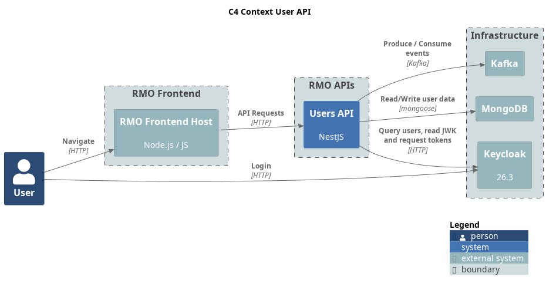

= Rolemaster Unified Users API

API for user management to set user preferences such as language, drive system.
It also includes the friendship management model needed to create games.

This project is part of RMU Online: https://github.com/labcabrera/rmu-platform

WARNING: *This application is an independent project developed by fans of Rolemaster Unified. It is not affiliated with, endorsed by, or licensed by Iron Crown Enterprises (ICE), the owners of the Rolemaster intellectual property.*
*All Rolemaster trademarks, game systems, and materials are the property of Iron Crown Enterprises. This software is provided for personal, non-commercial use only. If you enjoy Rolemaster, please support the official publications and content from ICE.*

== Description



== Running locally

Start the infrastructure from `rmu-platform` (`make up-infra`), copy `.env.example` to `.env` and run `pnpm start:dev` (see <<Development>>).
The service listens on `PORT` (default 3010) and serves Swagger UI at `/api-docs`.
Every variable is validated at startup by the Joi schema in `src/config/env.schema.ts`; a missing one stops the service.

[cols="1,3"]
|===
|Variable |Purpose

|`PORT` |HTTP port (default 3010).
|`RMU_MONGO_USERS_URI` |MongoDB connection string.
|`RMU_IAM_JWK_URI` |Keycloak JWKS used to verify the RS256 signature of access tokens.
|`RMU_IAM_ISSUER_URI` |Expected `iss` claim (public issuer, `http://localhost/sso/realms/rmu` locally).
|`RMU_IAM_AUDIENCE` |Audience that `aud` must contain (`rmu-api`).
|`RMU_IAM_TOKEN_URI`, `RMU_IAM_CLIENT_ID`, `RMU_IAM_CLIENT_SECRET` |Client credentials of the service account used for the admin API.
|`RMU_IAM_ADMIN_URI` |Keycloak admin API of the realm (users and groups only).
|`RMU_KAFKA_BROKERS`, `RMU_KAFKA_CLIENT_ID`, `RMU_KAFKA_DEFAULT_PARTITIONS` |Kafka producer for the user events.
|`RMU_USERS_ACTIVATION_CODE_SIZE` |Length of generated activation codes (default 8).
|`RMU_HTTP_TIMEOUT_MS` |Timeout of the Keycloak token and admin API calls (default 10000); after it the request answers `504 upstream-timeout`.
|===

The HTTP variables (`RMU_CORS_ORIGINS`, `RMU_THROTTLE_*`, `RMU_TRUST_PROXY`) are described in <<Development>>.

== Authentication

Every endpoint except `/v1/health` requires a Keycloak access token (`Authorization: Bearer ...`).
The token must be signed with RS256 by a key of `RMU_IAM_JWK_URI`, have `iss = RMU_IAM_ISSUER_URI` and an `aud` that contains
`RMU_IAM_AUDIENCE`; anything else gets `401`. The request user is mapped from the claims: `id = sub`, `email`,
`emailVerified = email_verified`, `username = preferred_username`, `given_name`, `family_name`, `name`, `roles = groups`
and `identityProvider = identity_provider` (`local` when the claim is absent).

== Profiles

Keycloak owns the identity; this API owns the RMU profile (display name, image, settings).

* `GET /v1/users/me` reads the profile by `_id = sub`. On first access it creates it from the token claims, with no call to the
  Keycloak admin API. Afterwards it only writes when a fingerprint of the claims (`email`, `email_verified`,
  `preferred_username`, `given_name`, `family_name`, `groups`, identity provider) changes, or to refresh `lastLoginAt`, which is
  written at most once per hour.
* The display name `name` is unique (case-insensitive). A new profile takes it from `preferred_username`, or from the email local
  part for brokered logins (Google) and usernames that look like an email, sanitized and with `-2`, `-3`... on collision.
* `PATCH /v1/users/me` changes `name` (3 to 32 letters, digits, spaces, `.`, `_`, `-`), `settings` and `imageUrl` in the profile only;
  Keycloak is never modified. A taken name answers `409`. The profile must exist (`404` otherwise; call `GET /me` first).
* `features` mirrors the `groups` claim.

Response of `GET` and `PATCH /v1/users/me`:

[source,json]
----
{
  "id": "b9d2b52d-...", "name": "alice", "email": "alice@example.com", "emailVerified": true, "enabled": true,
  "features": ["rmu-user"], "settings": { "measurementSystem": "imperial" }, "imageUrl": null,
  "identityProvider": "local", "firstName": "Alice", "lastName": "Liddell", "lastLoginAt": "2026-10-19T10:00:00.000Z",
  "createdAt": "2026-10-19T10:00:00.000Z", "updatedAt": null
}
----

* `GET /v1/users/search?name=<prefix>&page=0&size=10` (any authenticated user) returns a page of the public projection
  `{ "content": [{ "id", "name", "imageUrl" }], "pagination": { "page", "size", "totalElements", "totalPages" } }`.
  The match is a case-insensitive prefix on the display name; `size` is at most 20.
* `GET /v1/users?q=<rsql>` returns full profiles and is reserved to the `rmu-admin` group (`403` otherwise).

The Keycloak calls (service account token and admin API) go through the shared `HttpClient`
(`src/modules/shared/infrastructure/http/http-client.ts`, the same in every API that calls another one): a Keycloak that does
not answer in `RMU_HTTP_TIMEOUT_MS` is a `504` (`upstream-timeout`), one that cannot be reached or answers an error a `502`
(`bad-gateway`), and a `400`/`422` a `400`.

The Keycloak admin API is only used in two places: to resolve a friendship addressee that has no RMU profile yet (exact username,
or exact email when the input looks like one; the profile is then created from the admin representation), and to add the user to
the groups of a redeemed activation code.

== Events

Profile creation and changes publish `UserCreated` and `UserUpdated` on `internal.rmu-users.user.created.v1` and
`internal.rmu-users.user.updated.v1`. `lastLoginAt`-only writes publish nothing. Publishing is fire and forget: a Kafka error is
logged and never fails the request.

== Activation codes

* Creating, listing, reading, changing and deleting codes (`/v1/activation-codes`, `/{id}`) is reserved to `rmu-admin`
  (`403` otherwise). Any admin manages every code, whoever created it.
* `POST /v1/activation-codes/check` with `{ "code" }` looks the code up by exact value: `400` when unknown or expired, `409` when
  already used.
* `POST /v1/activation-codes/activate` with `{ "code" }` redeems a code once: it records `activatedBy` and `activatedAt` atomically,
  then adds the user to the Keycloak groups of the code's features. A used code answers `409`, an unknown one `404`, an expired
  one `400`. If the group assignment fails the code is released.

* The code value is unique across owners (index `code_1`, unique): a value taken by another code, whoever owns it, answers
  `409 duplicate-key`.

=== Moving an existing database to the unique index

Before spec 021 the unique index was `owner` + `code`, so two admins could share a value. Mongoose does not replace an
existing index, so a database created before needs `scripts/activation-code-unique-index.mjs` once. It reads the connection
string from `RMU_MONGO_USERS_URI` in the environment (never from `.env`), lists the values that several codes share and,
outside a dry run, replaces `code_1` and `owner_1_code_1` with the unique `code_1`. With duplicates it changes nothing and
exits with `1`; resolve them by hand first (keep the redeemed code, delete or change the others).

[source,bash]
----
export RMU_MONGO_USERS_URI='mongodb://<user>:<password>@<host>:27017/rmu-users?authSource=admin'
DRY_RUN=1 node scripts/activation-code-unique-index.mjs   # report only
node scripts/activation-code-unique-index.mjs             # create the unique index (idempotent)
----

== Friendships and messages

Creating (a friendship request, a message) needs the `rmu-user` or `rmu-admin` group: a token without groups is read-only
(`403`). Everything else is personal and needs no group:

* a friendship is read and deleted by its two participants, and answered (`PATCH`) by its addressee (`403` to the requester).
  Anybody else, admins included, gets `404`, as if it did not exist;
* the status follows `pending` -> `accepted` | `rejected` | `blocked` and `accepted` -> `blocked`; the same status again is no
  change, anything else a `400 invalid-status-transition`. A new request between two users answers `409` while their
  friendship is pending, accepted or blocked, and reopens a rejected one (pending again, from whoever asks now). The
  addressee is the user of `addresseeName`; participants are compared by id;
* a message goes to a user that exists (`404` otherwise) and is an accepted friend of the sender (`403 not-friends`
  otherwise); an `rmu-admin` (the service account among them) sends to any user. Only the recipient reads, marks as read and
  deletes it; anybody else gets `404`.

== Errors

Domain errors are returned as `{ "error": "<ErrorName>", "message": "...", "timestamp": "..." }` with the status of the error
(`400` validation, `403` forbidden, `404` not found, `409` conflict). Invalid request bodies or query parameters are rejected
by the global `ValidationPipe` (`whitelist`, `transform`) with `400`; unknown properties are stripped.

== Development

This API follows the platform and conventions of https://github.com/labcabrera/rmu-api-core[rmu-api-core] (workspace
spec 020): Node.js 24 (`nvm use`), pnpm 10 through corepack, native ESM with relative `.js` imports, SWC build, Vitest
and the hexagonal + CQRS layout of core's README (*Project layout*, *HTTP contract*).

```bash
cp .env.example .env   # host ports of the rmu-platform infrastructure (make up-infra)
pnpm install
pnpm start:dev         # http://localhost:3010, Swagger UI on /api-docs, OpenAPI JSON on /api-spec
make check             # lint, typecheck, unit and e2e tests
```

[cols="1,3"]
|===
| Command | What it does

| `pnpm build` / `pnpm typecheck` | SWC build to `dist/` / `tsc --noEmit`
| `pnpm lint` / `pnpm format` | typed ESLint + Prettier / Prettier over `src` and `test`
| `pnpm test` | unit tests (`test/unit`)
| `pnpm test:e2e` | one file per resource booting `AppModule` against mongodb-memory-server, with tokens signed against a local JWKS; calls to other APIs and the Kafka producer are replaced (`test/e2e/support`)
| `pnpm test:cov` | unit and e2e tests with the coverage thresholds of `vitest.config.ts` (what CI runs)
| `make docker-build` / `make docker-run` | image `labcabrera/rmu-api-users:latest` (`node:24-bookworm-slim`, `node` user, `HEALTHCHECK`); `docker-run` needs `.env.docker`
| `make create-release` | semantic-release from a clean `develop` into `master`
|===

The Joi schema in `src/config/env.schema.ts` fails startup on a missing required variable. Besides `PORT` (`3010`),
`LOG_LEVEL` (`info`) and `RMU_MONGO_USERS_URI`, the HTTP layer reads `RMU_CORS_ORIGINS` (empty: no CORS, browsers come through the
gateway), `RMU_THROTTLE_LIMIT` / `RMU_THROTTLE_TTL_MS` (`300` per `60000` ms and client IP, `0` turns it off) and
`RMU_TRUST_PROXY` (`loopback, linklocal, uniquelocal`).

Errors answer `{ statusCode, error, code, message, timestamp, path }`, with `path` without the query string. Responses carry the `version` of the entity and a
`PATCH` may send it back: a stale one is a 409 `version-conflict`. `size` goes up to 100.
Ports are interfaces with a `Symbol` DI token next to them (`USER_REPOSITORY`, `IAM_USER_PORT`, `ACTIVATION_CODE_REPOSITORY`,
`USER_MESSAGE_REPOSITORY`, `FRIENDSHIP_REPOSITORY`), as in core: no abstract classes as tokens. A `PATCH` that changes nothing
neither writes nor publishes: the handlers ask the aggregate (`hasChanges()` of `BaseAggregateRoot`, which compares the state
with the one loaded, without `updatedAt`). Events carry `producer` = `RMU_KAFKA_CLIENT_ID`.
Open problems found during the migration are listed in `docs/reports/api-template-rollout-findings.md` of the workspace.
